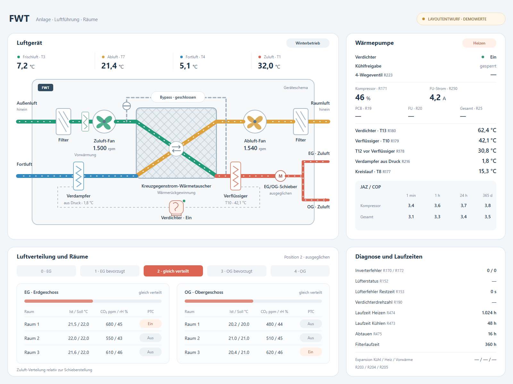

# FWT-Entwurf mit überarbeiteten Proportionen

Der erste kompakte Entwurf hatte zu kleine Lüfter, ein zu großes Bauteil im Zuluftweg und viel leere Gehäusefläche. Beschriftungen am Verteiler drängten sich zusammen. Die überarbeitete Grafik verwendet ein einheitliches Raster für Bauteile, Abstände, Texte und Messwertzeilen.

## Geänderte Proportionen

- Das Gerätegehäuse hat ein Breiten-Höhen-Verhältnis von ungefähr 1,94 zu 1. Es orientiert sich damit an der Form der FWT 2; die innere Anordnung bleibt eine Prinzipskizze.
- Beide Lüfter verwenden dasselbe Symbol und denselben Durchmesser. Der zentrale Wärmetauscher ist größer, Filter und Wärmepumpenregister sind schmaler. Vorwärmung vor dem Zuluft-Fan und Verflüssiger nach der Wärmerückgewinnung sind separat bezeichnet.
- Verdampfer und Verflüssiger liegen an den jeweiligen Luftwegen. Der Verdichter belegt den unteren Gerätebereich. Die gestrichelten Verbindungen zeigen nur die symbolische Zusammengehörigkeit der Wärmepumpenkomponenten, keinen vollständigen Kältemittel-Rohrplan.
- Eine zweite große Kältekreisgrafik entfällt. Die rechte Karte zeigt die zugehörigen Sensorwerte in gleichmäßig ausgerichteten Zeilen.
- Beide Etagenkarten sind gleich groß. Ihre Balken und die zwei Ausgänge haben im Heiz-Demo dieselbe Zuluftfarbe. Bei Schieberposition 2 sind beide Balken gleich lang.

## Was sich an der Anlagenansicht orientiert

- Das DIBt-Prinzipbild für die FWT 2 zeigt ein kompaktes Zentralgerät mit Filter, zwei EC-Ventilatoren, Sommerbypass, Kreuzgegenstromwärmetauscher, Wärmepumpenkomponenten und Energieregler. Es kennzeichnet Frischluft, Fortluft, Abluft sowie getrennte Zuluftausgänge für EG und OG.
- Das Herstellerdatenblatt beschreibt das Gerät als kompaktes Gehäuse mit seitlichen Luftanschlüssen und integriertem Energieregler, der die Luft- und Energiemengen auf zwei Zuluftanschlüsse verteilt.
- Die Grafik zeichnet ein eigenes Geräteschnittbild. Die beiden Diagonalwege im Kreuzstromkern bleiben sichtbar; Bypass, Wärmepumpenkomponenten und Energieregler sind als eigene Bauteile erkennbar. Der geschlossene Demo-Bypass erscheint grau und ohne Luftbewegung.

## Anordnung in der Kachel

1. **Oben links:** Geräteansicht mit vier Temperaturwerten, Lüfterdrehzahlen, Filtern, Bypass und den zwei Zuluftausgängen.
2. **Oben rechts:** Wärmepumpenstatus, Leistungswerte und Kältekreis-Messpunkte.
3. **Unten links:** Fünfstufige EG/OG-Verteilung mit Raumzeilen und PTC-Status.
4. **Unten rechts:** Fehler, Lüfterzustand, Laufzeiten, Verdichterdrehzahl und Expansionsventile.

Alle Zahlen, Zustände und Raumzeilen sind synthetische Demodaten. Sie zeigen bewusst eine gefüllte Kachel; sie belegen weder eine Messung noch eine fertige Register- oder Raumzuordnung. Ungeklärte Einheiten und Ventilcodes bleiben als Strich dargestellt. Raumzuordnung, PTC-Relais und weitere Sensoren müssen für die tatsächliche Einbindung konfiguriert bzw. bestätigt werden. EG/OG-Balken zeigen nur die relative Schieberstellung, keine gemessenen Volumenströme je Raum.

Die frühere Variante [05-fwt-kompakt-vorschlag.svg](05-fwt-kompakt-vorschlag.svg) bleibt zum Vergleich erhalten. Die aktuelle Fassung liegt als [SVG](06-fwt-proportionen.svg) und [PNG](06-fwt-proportionen.png) vor.

## Quellen

- [DIBt-Zulassung Z-51.3-342, Anlage 1](https://www.dibt.de/pdf_storage/2020/Z-51.3-342%281.51.3-28%2120%29.pdf) – Prinzipbild und Bezeichnungen A–P.
- [PROXON FWT 2 2.0 Datenblatt](https://www.zimmermann-lueftung.de/fileadmin/user_upload/downloads/Datenblatt_PROXON_FWT-2_2.0.pdf) – Geräteaufbau, Anschlüsse, Maße und integrierte Baugruppen.
- [PROXON FWT-Serie Zentralgerät](https://www.zimmermann-lueftung.de/komforttechnik/die-proxon-geraete/proxon-fwt-serie-zentralgeraet/) – Zonenregelung, Raumdaten und Bedienkonzept.

Die SVG und PNG sind statische Entwürfe. Die aktive HTML-Kachel wurde noch nicht umgebaut.
