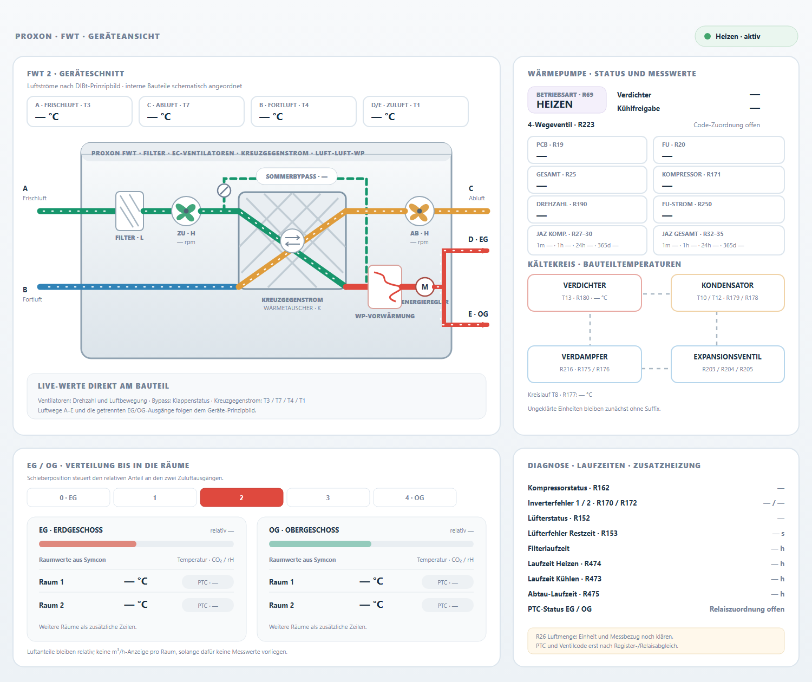

# Kompakter FWT-Entwurf nach Hersteller- und DIBt-Unterlagen

Die vorherige Variante stellte Anlagenprozess und Messwerte als lange Panoramaansicht nebeneinander. Dieser Entwurf setzt stattdessen das Gerät in den Mittelpunkt und ordnet die Informationen in vier annähernd gleichwertigen Feldern darum an.

## Was sich an der Anlagenansicht orientiert

- Das DIBt-Prinzipbild für die FWT 2 zeigt ein kompaktes Zentralgerät mit Filter, zwei EC-Ventilatoren, Sommerbypass, Kreuzgegenstromwärmetauscher, Wärmepumpenkomponenten und Energieregler. Es kennzeichnet Frischluft, Fortluft, Abluft sowie getrennte Zuluftausgänge für EG und OG.
- Das Herstellerdatenblatt beschreibt das Gerät als kompaktes Gehäuse mit seitlichen Luftanschlüssen und integriertem Energieregler, der die Luft- und Energiemengen auf zwei Zuluftanschlüsse verteilt.
- Die neue Grafik zeichnet deshalb ein eigenes Geräteschnittbild statt eines durchlaufenden Luftkanals. Die beiden Diagonalwege im Kreuzstromkern bleiben sichtbar; Bypass, Wärmepumpen-Vorwärmung und Energieregler sitzen an der jeweiligen Prozessstelle.

## Anordnung in der Kachel

1. **Oben links:** Geräteansicht mit vier Temperaturwerten, Lüfterdrehzahlen, Filter, Bypass und Luftwegen A–E.
2. **Oben rechts:** Wärmepumpenstatus, Leistungswerte und Kältekreis-Messpunkte.
3. **Unten links:** Fünfstufige EG/OG-Verteilung mit Raumzeilen und PTC-Status.
4. **Unten rechts:** Fehler, Lüfterzustand, Laufzeiten und offene Registerzuordnungen.

Der Entwurf verwendet neutrale Platzhalter statt Live- oder Hauswerten. Die Raumzeilen sind als Vorschau für Werte aus den vorhandenen Symcon-Rauminstanzen gedacht. PTC bleibt als „nicht zugeordnet“ markiert, bis Relais und Räume eindeutig verknüpft sind. EG/OG-Balken zeigen nur die relative Schieberstellung, solange keine belastbaren Volumenstrommessungen je Raum vorliegen.

## Quellen

- [DIBt-Zulassung Z-51.3-342, Anlage 1](https://www.dibt.de/pdf_storage/2020/Z-51.3-342%281.51.3-28%2120%29.pdf) – Prinzipbild und Bezeichnungen A–P.
- [PROXON FWT 2 2.0 Datenblatt](https://www.zimmermann-lueftung.de/fileadmin/user_upload/downloads/Datenblatt_PROXON_FWT-2_2.0.pdf) – Geräteaufbau, Anschlüsse, Maße und integrierte Baugruppen.
- [PROXON FWT-Serie Zentralgerät](https://www.zimmermann-lueftung.de/komforttechnik/die-proxon-geraete/proxon-fwt-serie-zentralgeraet/) – Zonenregelung, Raumdaten und Bedienkonzept.

Die SVG und PNG sind statische Entwürfe. Die aktive HTML-Kachel wurde noch nicht umgebaut.
