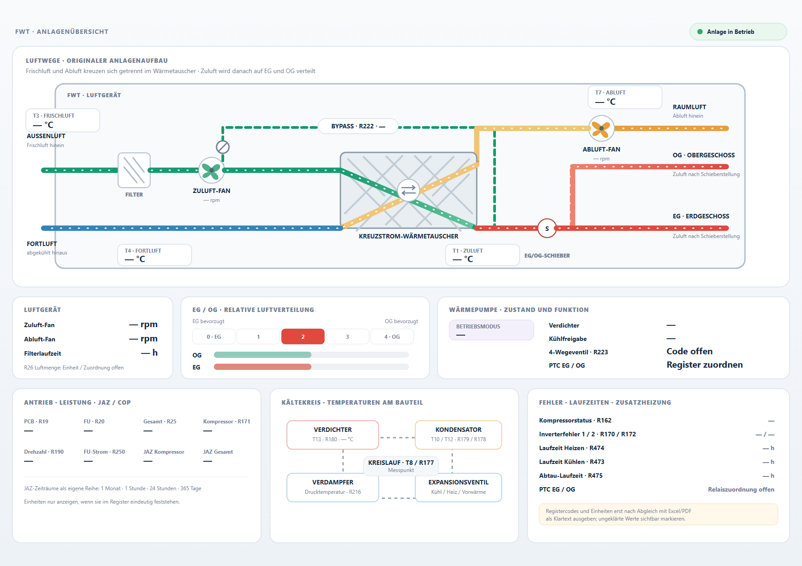

# FWT-Kachel: Anpassungsvorschlag nach Symcon-Screenshot

Die aktuelle Ansicht enthält die richtigen Informationen, verteilt sie aber auf zwei gleich starke Spalten. Dadurch schrumpfen besonders die Messwerttexte. Zusätzlich liegen Symcons Instanzname und die eigene große Überschrift nah übereinander.

## Vorschlag

Die Vorschau [04-fwt-layout-vorschlag.svg](04-fwt-layout-vorschlag.svg) zeigt eine klarere Rangfolge:

1. **Anlagenluftweg über die ganze Kachelbreite.** Der Kreuzstrom-Wärmetauscher bleibt zentral und zeigt weiterhin zwei getrennte, diagonal kreuzende Luftwege. Temperaturwerte, Lüfterdrehzahlen, Bypass sowie die Abzweigung nach EG und OG stehen direkt am Prozess.
2. **Drei gut lesbare Statuskarten darunter.** Luftgerät, relative EG/OG-Verteilung und Wärmepumpenzustand bekommen jeweils eine eigene Karte. Die fünf Schieberpositionen und die beiden Etagenbalken bleiben sichtbar.
3. **Wärmepumpenwerte nach Themen gruppiert.** Antrieb/JAZ, Kältekreis und Fehler/Laufzeiten liegen in einem eigenen unteren Bereich. Die Kältekreis-Komponenten behalten ihre physische Zuordnung.
4. **Kopfbereich entschlacken.** Die Kachel wiederholt nicht mehr den großen Namen „Anlagensteuerung“ als zweite Überschrift; oben bleibt nur eine kleine FWT-Kennung mit Betriebsstatus.

## Daten, die weiterhin gekennzeichnet werden müssen

- EG-/OG-Balken und Kanalstärken bilden nur die relative Schieberstellung ab, solange keine verlässlichen Volumenströme je Etage vorliegen.
- R26 bleibt als Luftmenge markiert, bis Einheit und Messzuordnung geklärt sind.
- Betriebsmodus, Verdichterstatus, 4-Wegeventil und PTC-Zustände brauchen eine geprüfte Register- bzw. Relaiszuordnung.
- R19/R20/R25 sowie R190 erhalten erst dann eine Einheit, wenn sie anhand der Registerunterlagen bestätigt ist.

Die SVG ist ein statischer Layoutentwurf mit Platzhaltern, keine Änderung der aktiven HTML-Kachel. Die Diagrammgeometrie und Registerbindung können nach Abstimmung in die bestehende Kachel übernommen werden.
